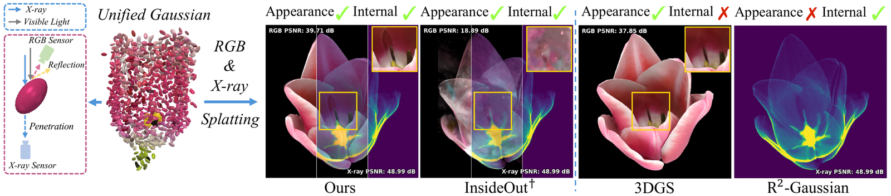
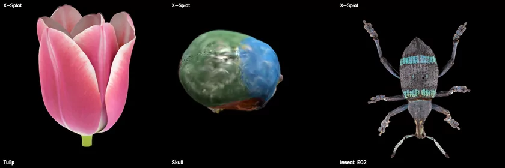

<h1 align="center">
  X-Splat: Unified Gaussian Splatting for<br>Joint RGB and X-ray 3D Reconstruction
</h1>

<p align="center">
  <a href="https://zezeaaa.github.io/">Wangze Xu</a><sup>1</sup>,
  <a href="https://fourson.github.io/">Chu Zhou</a><sup>2</sup>,
  Mae Yamaguchi<sup>1</sup>,
  <a href="https://scholar.google.com/citations?user=bUeZN3gAAAAJ&hl=en">Linrui Dai</a><sup>1</sup>,
  <a href="https://jdily.github.io/">I-Chao Shen</a><sup>1</sup>,
  Takashi Ijiri<sup>3</sup>,
  <a href="https://scholar.google.com/citations?user=gtfbzYwAAAAJ&hl=en">Imari Sato</a><sup>2,1</sup>
</p>

<p align="center">
  <sup>1</sup>The University of Tokyo,
  <sup>2</sup>National Institute of Informatics,
  <sup>3</sup>Shibaura Institute of Technology
</p>

<p align="center">
  <a href="https://arxiv.org/abs/2610.23237"></a>
  <a href="https://zezeaaa.github.io/X-Splat/"></a>
</p>

<h3 align="center">SIGGRAPH Asia 2026 Conference Papers</h3>

<p align="center">
  
</p>

X-Splat reconstructs an object's **appearance** and its **internal structure** in one set of
3D Gaussians, from RGB photographs and X-ray projections.

<p align="center">
  
</p>

## Overview

| Step | Entry point | What it does |
|---|---|---|
| Data preparation | `preprocess.py` | camera poses (COLMAP), X-ray projections (TIGRE), MVS point cloud |
| Stage 1 | `train.py` | 3,000 iterations on the X-ray projections alone: density field and CT surface |
| Alignment | `train.py` | PCA + ICP: the sim(3) from the RGB frame to the X-ray frame |
| Stage 2 | `train.py` | 12,000 joint iterations on shared Gaussians, with the surface set, the CT-guided depth loss and 180 virtual views |
| Evaluation | `eval.py` | X-ray 2D/3D and RGB metrics |
| Rendering | `render_video.py` | orbit videos of the RGB, the X-ray and their overlay |

## Installation

Tested on Linux with an NVIDIA RTX 6000 Ada / A6000 (48 GB): data preparation needs up to about
40 GB of GPU memory (MVS), training and evaluation about 20 GB. Building the CUDA extensions needs the
CUDA 11.8 toolkit (`nvcc`, found through `CUDA_HOME`) and gcc 11 or older.

```bash
git clone --recursive https://github.com/zezeaaa/X-Splat.git && cd X-Splat
conda create -n xsplat python=3.10 -y && conda activate xsplat
pip install torch==2.1.2 torchvision==0.16.2 --index-url https://download.pytorch.org/whl/cu118
pip install -r requirements.txt
# compiled for the visible GPU; with none visible, first set the target GPUs for this and later runs
# conda env config vars set TORCH_CUDA_ARCH_LIST="8.6;8.9"; conda deactivate; conda activate xsplat
pip install -e third_party/xray-gaussian-rasterization-voxelization --no-build-isolation
pip install -e third_party/simple-knn --no-build-isolation
# gsplat compiles its CUDA kernels on first use; do it here instead of in the first training run
python -c "from gsplat.cuda._backend import _C"
# the VGG weights LPIPS uses (about 530 MB), otherwise downloaded by the first RGB test
python -c "import lpips; lpips.LPIPS(net='vgg')"
```

### Data preparation tools

Needed to build scene packages from raw data (InsideOut, Flower, your own data); not needed
for the downloaded insect scene packages.

```bash
# TIGRE 2.3 does not build with Cython 3
pip install timm==0.9.12 cython==0.29.36
wget https://github.com/CERN/TIGRE/archive/refs/tags/v2.3.zip && unzip v2.3.zip
pip install TIGRE-2.3/Python --no-build-isolation && rm -rf TIGRE-2.3 v2.3.zip
```

* [COLMAP](https://colmap.github.io/) 3.8 to 3.12, built with CUDA (3.13 renamed options this code uses); set `rgb.colmap` in `configs/preprocess/default.yaml` if it is not on `PATH`
* [Blender 3.6.5](https://download.blender.org/release/Blender3.6/blender-3.6.5-linux-x64.tar.xz), for Flower only: unpack it anywhere and pass its binary as `scripts/prepare_flower.py --blender /path/to/blender-3.6.5-linux-x64/blender`
* [MVSFormer](https://github.com/ewrfcas/MVSFormer)'s `MVSFormer-Blended/best.pth` from its [pretrained models](https://1drv.ms/u/s!Ah2VkULmkiqPryH_Tl2PUS6Is831?e=BgCuOY) (a OneDrive folder, to open in a browser), saved as `third_party/mvsformer/pretrained/MVSFormer-Blended/best.pth`; the backbone weights its README also lists are not needed

## Data

| Dataset | Source | Preparation |
|---|---|---|
| **Insect** (E02, E15, E32), ours | [download](DATA.md#downloads) | none |
| **InsideOut** (matryoshka, pharaoh, skull, toy_gun) | [request from Lee et al. (ICCV 2025)](https://leejngmn.github.io/InsideOut.github.io/) | `scripts/prepare_insideout.py`, then `preprocess.py` |
| **Flower** (Tulip, Eustoma) | [RIKEN flower CT library](https://www2.riken.jp/brict/Ijiri/flowerctlib/index.html) | `scripts/prepare_flower.py`, then `preprocess.py` |

[DATA.md](DATA.md) has the download links, the steps for each dataset, and how to
[bring your own data](DATA.md#your-own-data).

## Training

```bash
# dataset is insideout, flower or insect
python train.py dataset=insect data.scene_root=data/processed/insect/E02
# train and evaluate every prepared scene, one after another (about 2 hours on one GPU)
bash scripts/train_all.sh
# or pick the GPU and the scenes, e.g. one such command per GPU to use several at once
gpu_id=1 bash scripts/train_all.sh insect/E02 insect/E15
```

Results go to `outputs/<dataset>/<scene>/`:

```
outputs/insect/E02/
├── config.yaml    the settings of the run, read by eval.py and render_video.py
├── metrics.jsonl  the losses of every iteration
├── checkpoints/   the trained model
├── alignment/     the RGB-to-X-ray transform, the X-ray surface and the aligned MVS points
├── exports/       gaussians_rgb.ply (3DGS viewers), gaussians_xray.pickle (R²-Gaussian)
├── renders/       test views and orbit videos
└── evaluation/    metrics
```

## Evaluation and rendering

```bash
# X-ray 2D/3D and RGB metrics on the test views
python eval.py outputs/insect/E02
# orbit videos: RGB, X-ray and their overlay
python render_video.py outputs/insect/E02
# the metrics of all runs in tables, also saved as outputs/*_summary.csv
python scripts/collect_metrics.py outputs
# the paper's numbers in the same tables (data/metrics/ comes with the downloaded checkpoints)
python scripts/collect_metrics.py data/metrics/paper
```

## Citation

```bibtex
@inproceedings{xu2026xsplat,
  title     = {X-Splat: Unified Gaussian Splatting for Joint RGB and X-ray 3D Reconstruction},
  author    = {Xu, Wangze and Zhou, Chu and Yamaguchi, Mae and Dai, Linrui and
               Shen, I-Chao and Ijiri, Takashi and Sato, Imari},
  booktitle = {SIGGRAPH Asia 2026 Conference Papers},
  year      = {2026}
}
```

## License

Released under the **Gaussian-Splatting License** of 3D Gaussian Splatting
([LICENSE.md](LICENSE.md)): research and evaluation only, **non-commercial**. X-Splat builds
on [R²-Gaussian](https://github.com/Ruyi-Zha/r2_gaussian) and
[3D Gaussian Splatting](https://github.com/graphdeco-inria/gaussian-splatting), and its data
preparation uses [MVSFormer](https://github.com/ewrfcas/MVSFormer) and
[TIGRE](https://github.com/CERN/TIGRE); please cite them too. The code under
`third_party/` keeps its own licenses, and dataset citations are in [DATA.md](DATA.md).
